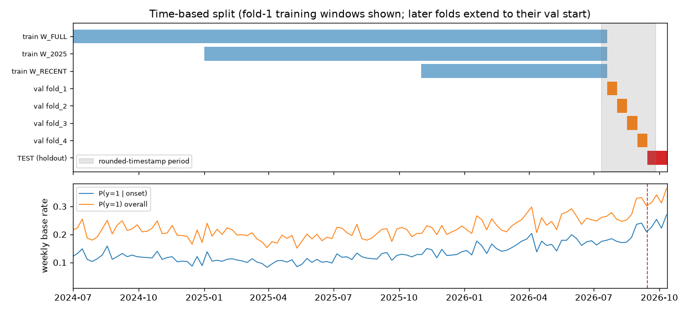
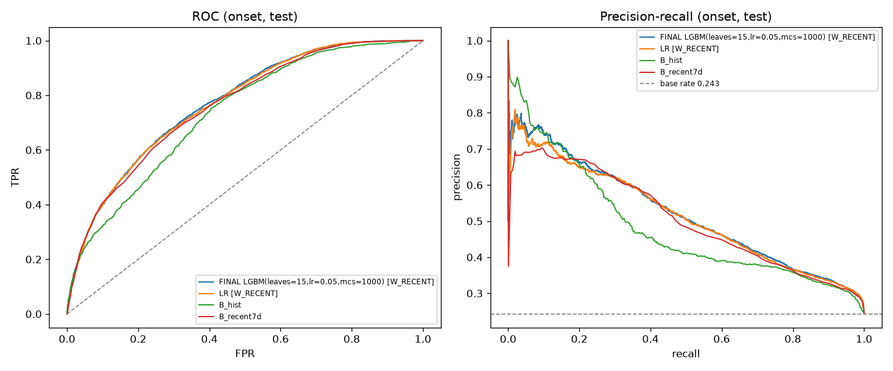
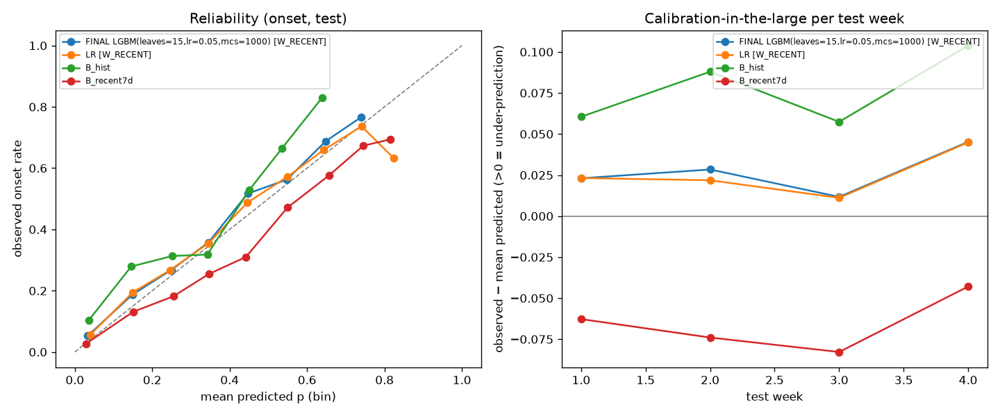
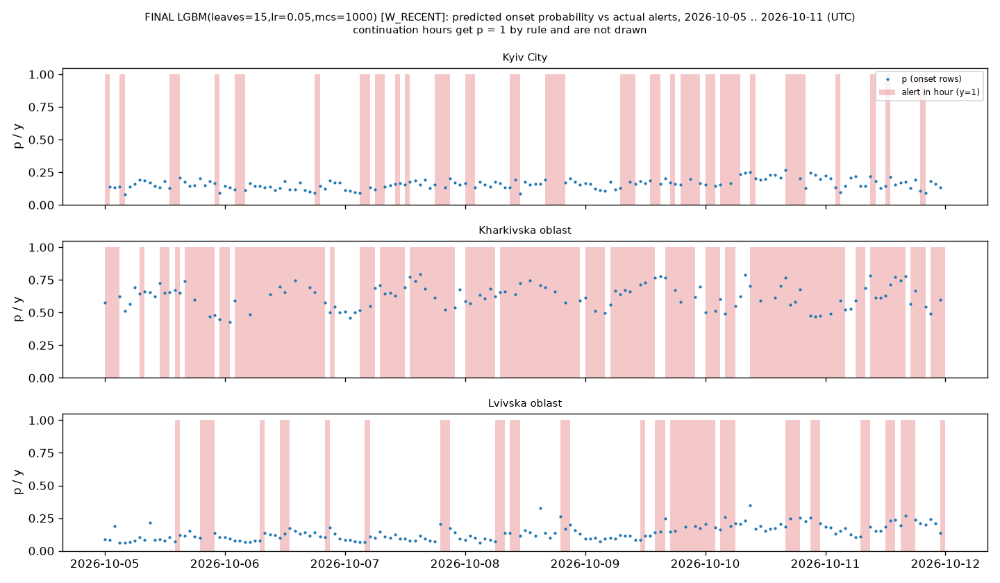

# Air-raid alert forecasting for Ukraine (1-hour horizon)

Hourly, per-oblast forecast of air-raid alerts in Ukraine, built as a leakage-safe time-series pipeline in
Python and evaluated once on the most recent four weeks of data (2026-09-14 to 2026-10-12, held out until
the end).

**Headline (test period, onset hours):** the final LightGBM model has an onset log loss of **0.462**,
compared with **0.518** for the per-region/hour historical rate and **0.478** for the region's own 7-day
alert frequency. It wins every test week against all baselines. Its advantage over logistic regression is
small (0.462 vs 0.464). Most of the signal is *which region is under pressure right now*. Timing within a
region is only weakly predictable (median within-region ROC-AUC 0.58).

---

## 1. Problem and framing

- **Unit:** one row per (region r, hour t). There are 24 regions: 23 oblasts plus Kyiv City.
- **Forecast time:** the instant `t`, i.e. the start of hour `t` in UTC. Everything known up to `t` may be used.
- **Target:** `y(r, t) = 1` if an air-raid alert is active in region `r` at any moment during `[t, t+1h)`.
- **Output:** a probability `p(r, t)`.

**Hybrid predictor: continuation vs onset.** If an alert is already active at instant `t`
(`start ≤ t < end`), it overlaps `[t, t+1h)` by a positive amount, so `y = 1` *deterministically*. The data
confirms this: 90,509 such rows, all with y = 1.000. These continuation rows are only 9% of all rows but
**48% of all positives**. Counting them as "predictions" would inflate every metric. The predictor therefore
has two parts:

| Regime | Condition at instant t | Prediction |
|---|---|---|
| continuation | an alert is active | `p = 1` (rule) |
| onset | no alert active | model probability that a new alert starts within the hour |

Models are trained only on onset rows, and every baseline uses the same wrapper. **Onset metrics are the
primary result.** Overall metrics are reported but labelled as inflated. For continuation rows we only check
that mean p = 1.

## 2. Data

- **Source:** [Vadimkin/ukrainian-air-raid-sirens-dataset](https://github.com/Vadimkin/ukrainian-air-raid-sirens-dataset)
  (MIT), file `datasets/volunteer_data_en.csv` (eTryvoga channel). The snapshot is source commit `d10c80f`
  from 2026-10-12 05:05 UTC.
- **Why volunteer data over official data:** the official file stops on 2026-09-07 (35 days stale), and since
  December 2025 it is almost entirely raion/hromada level. The volunteer file is updated daily and is
  oblast-level. Official data is used **only for validation**:
  - proving the timestamps are UTC;
  - justifying the long-alert cap;
  - detecting label-regime changes.
- **Timezone:** UTC, proven in two ways.
  - On 10 Oct 2022, Kyiv Post reported the Kyiv alert starting at 06:47 local time (EEST). The data has it at
    03:47:17 UTC.
  - 70% of volunteer starts are within 2 minutes of an official start, with no clusters at ±1/2/3 h offsets.
- **Panel:** 2022-02-25 17:00 UTC to `PANEL_END` = 2026-10-12 00:00 UTC (the last, incomplete day is
  dropped). That is 973,032 rows; after the 168 h warm-up, 969,000 rows have features.

**Cleaning rules** (`src/preprocess.py::clean_alerts`):

| Rule | Rows | Reason |
|---|---|---|
| Drop Luhanska oblast | 3 | Permanent alert since 2022-04-04 (Crimea is absent from the data) |
| Drop alerts with end ≤ start | 6 | Zero duration |
| Cap non-naive alerts longer than 12 h to start + 30 min (`end_capped=True`) | 28 | Missed end signals. Official data shows only short alerts inside them. Below 12 h, 85–90% of long alerts are genuine (front-line oblasts) |
| Keep `naive` alerts (end imputed as start + 30 min by the source) | 5,834 | Documented imputation; flagged as `any_naive` |

## 3. Features

Information rule: a feature for row `(r, t)` may use alert starts and ends with timestamp ≤ `t`, and panel
rows for hours ≤ `t−1`. `y(r, t)` and `alert_minutes(r, t)` are **never** inputs for row `t`.

| Feature | Definition | Information used |
|---|---|---|
| `active_now` | alert active in r at instant t | intervals with start ≤ t < end (defines the regime; constant on onset rows) |
| `current_alert_age_min` | minutes since the active alert started | same (0 on onset rows) |
| `hours_since_last_end` | hours since the last alert in r ended (cap 168) | ends ≤ t |
| `y_lag_{1,2,3,24,168}` | y of hour t−k | panel rows ≤ t−1 |
| `minutes_lag_1` | alert minutes in hour t−1 | panel row t−1 |
| `y_roll_{6h,24h,7d}` | sum of y over the window ending at t−1 | panel rows ≤ t−1 |
| `n_regions_active_now`* | other regions with an active alert at t | intervals ≤ t |
| `n_regions_alert_last_hour`* | other regions with y = 1 at t−1 | panel rows t−1 |
| `national_roll_24h`* | alert-hours across all regions, last 24 h | panel rows ≤ t−1 |
| `n_neighbours_active_now`, `share_neighbours_active_now` | land-border neighbours with an active alert at t | intervals ≤ t, `src/adjacency.py` (50 edges, manually reviewed) |
| `n_neighbour_onsets_last_hour` | neighbours whose alert started in [t−1h, t) | starts < t |
| `hour`, `dow` (+ sin/cos) | Kyiv local time of t | calendar |
| `region` | categorical | — |

\* The **national** group was removed from the shipped models: in the ablation it changed onset log loss by
−0.0003 and its effect was not consistent across folds. It is still computed so the ablation stays
reproducible (`FEATURE_GROUPS` in `src/config.py`).

## 4. Leakage safeguards

- **Past-only construction:** every lag and rolling feature is shifted so that hour `t−1` is the latest
  input. State features use `start ≤ t`.
- **Future-perturbation test** (`tests/test_leakage.py`): at 4 cut-offs T (one is the DST switch, one is
  mid-hour) we change everything after T:
  - delete future alerts;
  - re-draw the ends of alerts active at T;
  - inject fake alerts, including in the first hour after T.

  All features for rows with `t ≤ T` must stay bit-identical.
- **Own-target test:** flipping `y` and `alert_minutes` of a single row `(r, t)` must not change that row's
  features.
- **Boundary tests:** an alert starting exactly at `t` is `active_now`; one starting at `t + 1 s` changes
  nothing at `t`.
- **Mutation testing:** I deliberately injected leaks and checked that the tests fail. All of these were
  caught:
  - rolling window without shift;
  - lags off by one;
  - `active_now` looking 1 h ahead;
  - neighbour onsets of the current hour;
  - national count using y(t);
  - train/validation overlap (gap −1 h);
  - validation fold inside the test period;
  - removed holdout guard;
  - hybrid rule returning 0.99.

  Two mutations were *not* caught at first: the hour-boundary floor rule, which is protected redundantly,
  and `B_hist_recent` ignoring its window. A test was added for the latter.
- **Holdout guard:** `src/split.py` raises `HoldoutAccessError` if any model is fitted on rows with
  `t ≥ TEST_START`, or if test rows are requested from any file other than `src/evaluate.py`.
- **No shuffling.** Scalers and encoders are fitted per fold on that fold's training rows only. Baseline
  rates are computed on training rows only (tested by perturbing validation labels).
- **Pre-registration:** [`reports/evaluation_plan.md`](reports/evaluation_plan.md) was committed (`43dcbdd`)
  *before* the test period was scored for the first time.

## 5. Validation design



- **Test (holdout):** 2026-09-14 to 2026-10-12 (4 weeks). Used once, in Step 7.
- **Walk-forward:** 4 consecutive 2-week validation folds (2026-07-20 to 2026-09-14). Each fold trains on all
  data before it, in an expanding window from the chosen start. Folds are defined on timestamps, so every
  region of an hour is always in the same set.
  - **Gap = 0:** the horizon is 1 h, so the last training row's target window ends exactly at the start of
    validation, and every feature is past-only.
- **Training-window candidates:**
  - `W_FULL`: 2022-03;
  - `W_2025`: 2025-01-01;
  - `W_RECENT`: 2025-11-01, after the Volyn/Lviv label-regime change.
- **Staged search** (a deliberate choice that keeps compute at ~12 min instead of ~1.5 h):
  1. hyperparameters on `W_RECENT` (3 LR, 8 LightGBM);
  2. the best hyperparameters per model on all three windows;
  3. ablation on the chosen configuration.

  *Assumption:* hyperparameter optima transfer across windows. This is supported indirectly: all 8 LightGBM
  configurations were within 0.0006 log loss of each other.
- **Selection criterion:** mean onset log loss (a proper scoring rule) across folds, with PR-AUC secondary.
  - **Paired noise check:** fold difficulty varies a lot (onset base rate 0.17–0.22) and is shared by all
    models, so configs are compared by their *fold-wise paired difference*. Two configs count as different
    only if |mean diff| > std of the diffs *and* one wins every fold.
  - **Outcomes:** LightGBM beats LR on 4/4 folds (−0.0028). `W_RECENT` beats `W_FULL` on 4/4.
    `W_RECENT` vs `W_2025` is within noise, so I kept the smaller, more recent window.
- **Calibration:** I tested Platt scaling fitted on the last 2 weeks of each fold's *training* data. It won
  only 2/4 folds (paired −0.0001 ± 0.0004), so it was **not** adopted.

**Final model:** LightGBM (`num_leaves=15`, `learning_rate=0.05`, `min_child_samples=1000`), window
`W_RECENT`, onset rows only (164,378), without national features. The number of trees (211) comes from early
stopping on the last 2 weeks of the *training* data, after which the model is refit on all of it.

## 6. Results on the test period (2026-09-14 to 2026-10-12)

Onset rows: 14,215 (base rate **0.243**). Continuation rows: 1,913, with mean p = 1.0 for every model.

| Model (onset rows) | log loss ↓ | PR-AUC ↑ | ROC-AUC ↑ | Brier ↓ | mean p |
|---|---|---|---|---|---|
| B_persist (y_lag_1) | 4.094 | 0.300 | 0.597 | 0.296 | 0.242 |
| B_daily (y_lag_24) | 4.386 | 0.310 | 0.616 | 0.318 | 0.311 |
| B_weekly (y_lag_168) | 4.394 | 0.304 | 0.608 | 0.318 | 0.301 |
| B_recent7d (7-day own frequency) | 0.478 | 0.503 | 0.762 | 0.158 | 0.309 |
| B_hist (region × hour rate, W_RECENT) | 0.518 | 0.482 | 0.734 | 0.166 | 0.165 |
| Logistic regression (W_RECENT) | 0.464 | 0.514 | 0.769 | 0.152 | 0.218 |
| **LightGBM (final)** | **0.462** | **0.521** | **0.772** | **0.152** | 0.216 |

Overall metrics, which are inflated by continuation rows: final model log loss 0.407, PR-AUC 0.802, ROC-AUC
0.853. The 0/1 baselines have huge log loss by construction, because p is clipped to 1e-6.

**Weekly paired comparison** (onset log loss, final − other; negative = final better):

| vs | week 1 | week 2 | week 3 | week 4 | weeks won |
|---|---|---|---|---|---|
| B_hist | −0.036 | −0.056 | −0.045 | −0.087 | 4/4 |
| B_recent7d | −0.015 | −0.020 | −0.023 | −0.008 | 4/4 |
| LR | −0.001 | −0.002 | −0.000 | −0.003 | 4/4 (tiny) |





**Interpretation, honestly:**

- **Where the model adds value:**
  - It is much better calibrated than the simple baselines. B_hist under-predicts by 6–10 percentage points
    (the base rate keeps rising) and B_recent7d over-predicts by 4–8 pp (it counts continuation hours).
  - It ranks better: PR-AUC +0.018 over B_recent7d, +0.039 over B_hist.
  - It is the only model with some within-region timing skill. Median per-region ROC-AUC is 0.578, vs 0.505
    for B_recent7d and 0.542 for B_hist, and 9 of 23 regions are above 0.6
    (`reports/test_posthoc_within_region_auc.csv`, a post-hoc analysis).
- **Where it does not:**
  - Most of the pooled ROC-AUC comes from *which region is under pressure*. Gain importance:
    `y_roll_7d` 52%, `region` 26%. Within a region, hour-to-hour timing is weak. For Kyiv City the
    within-region AUC is 0.49 and p stays flat around 0.15 (timeline above).
  - LightGBM is only marginally better than logistic regression.
  - **Mass-attack hours** (≥ 10 regions with an onset in the same hour; 27 such hours): log loss is 0.756
    vs 0.449 for other hours, and mean p 0.23 vs an observed 0.48. The start of a large coordinated attack
    is not visible in past alert data.
  - **Under-prediction persists:** mean p is 0.216 vs an observed 0.243, in all 4 weeks (worst in week 4:
    0.224 vs 0.270). This was anticipated in the pre-registration, from the rising base rate.
- **Robustness:**
  - Without Volynska and Lvivska, onset ROC-AUC is 0.779 and PR-AUC 0.533 (vs 0.772 / 0.521), with
    unchanged log loss. The final model's ranking against the baselines is unchanged.
  - Positive onset hours whose alert had an imputed or capped end get much lower p (0.19 vs 0.37 for clean
    positives). This is consistent with those labels being noisier (post-hoc).
- **Validation vs test:** onset log loss was 0.387 on validation and 0.462 on test. The test period has a
  higher, harder base rate (0.243 vs 0.17–0.22). Relative orderings carried over unchanged.

All tables are in `reports/test_*.csv`, and the full console output is in `reports/evaluate_log.txt`.

## 7. Limitations

- **Label semantics:** the target is "volunteers (eTryvoga) recorded an oblast alert", not "any official
  alert in the oblast". Even in the oblast-level era, volunteers record only 61–68% of official alert-hours.
- **Volyn and Lviv regime change:** from Sep 2025 (Volyn) and Nov 2025 (Lviv), the volunteer series has
  5–10× more alert-hours than official data, and only ~10% of them overlap any official alert. This also
  feeds into the neighbour features of adjacent oblasts.
- **Collection anomaly from 2026-07-12 to 2026-09-25:** timestamps are rounded to 10 s in all regions, and
  agreement with official data drops (0.91 → 0.82). All validation folds and the first 12 test days fall in
  this window.
- **Label-cleaning look-ahead:** the `naive` (+30 min) and capped ends are known only in retrospect. In real
  time, those alerts would look active for longer. This affects ~5% of alerts (~10% in the test period).
- **Real-time feed assumption:** the features need every alert up to `t`, i.e. a live feed such as the
  alerts.in.ua API. The CSV itself is updated only daily.
- **Spatial resolution:** oblast level only. City-level alerts exist only for Kyiv, and raion/hromada alerts
  are not modelled.
- **Non-stationarity and calibration:** the onset base rate rose from 0.11 (2022–2026 average) to 0.24 in
  the test period. The model under-predicts by ~2.7 pp, and Platt scaling did not help on validation.
- **Retroactive edits:** the source may rewrite `naive` records later. This was not checked; it would
  require the full git history of the source repository.

## 8. Future work

- Raion/hromada- and city-level targets via the alerts.in.ua API (and validation of the last 30 days against it).
- Text features from news, official statements and public Telegram channels (e.g. reports of launched
  drones or missiles), using strictly content published before `t`. This is the most promising route for
  mass-attack hours.
- Recency weighting of training rows, or trend-aware calibration of the base rate.
- Multi-horizon targets (2–6 h, 24 h) and a continuation target such as "will the alert still be active at t+1h".

## 9. Development process (key turning points)

- **Data source switched to the volunteer file.** EDA showed the "official" file was 35 days stale and had
  moved to raion level.
- **Timezone proven rather than assumed.** I matched a news-reported alert time to the data and checked
  cross-source offsets.
- **Long-alert threshold derived from data.** The first idea was to treat > 24 h alerts as errors. Comparing
  against the union of official alerts showed 12–24 h alerts were mostly errors too, while 6–12 h ones were
  genuine, so the threshold became 12 h.
- **Anomalies found while justifying that threshold:** the Volyn/Lviv divergence and the rounded-timestamp
  collection period.
- **Framing correction:** proving that y ≡ 1 when an alert is active led to the hybrid continuation/onset
  predictor and to onset-only training and metrics.
- **Bugs in my own tests caught and fixed:**
  - the own-target test first failed because it changed 50 rows at once, which legitimately leaked into
    later lags;
  - a split test fixture mixed naive and tz-aware timestamps;
  - pytest tried to collect `TestPeriodAccessError` as a test class.
- **Evaluation search scaled down:** a full 228-fit grid (~1.5 h) was stopped and replaced by a staged
  search (~12 min), and the LR solver was switched to `newton-cholesky` after timing it.
- **Model-selection criterion changed** from overlapping fold standard deviations to a paired fold-wise test.
  The former would have called every config "equal".
- **Feature and calibration decisions made on validation only:** the national feature group was dropped and
  Platt scaling was rejected.
- **Pre-registration before the one-shot test.** Two post-hoc analyses were added afterwards and labelled as
  such. One replaced a pre-registered breakdown that turned out to be degenerate: the naive/capped flags exist
  only for y = 1 hours.

## 10. How to run

```bash
python -m venv .venv
.venv/Scripts/activate        # Windows; on Linux/macOS: source .venv/bin/activate
pip install -r requirements.txt
pytest -q                     # 38 tests
python main.py --skip-search  # fetch -> panel -> features -> final fit -> test evaluation (uses reports/selected_config.json)
python main.py                # same, plus the full walk-forward search (~15 min)
```

Individual stages are `python -m src.fetch`, `src.preprocess`, `src.features`, `src.walkforward`
(add `--stage2` for the follow-up stage), `src.train` and `src.evaluate`.
The EDA notebook is generated by `scripts/build_eda_notebook.py`.

`fetch` pulls the latest source data. `PANEL_END` and `TEST_START` are fixed in `src/config.py`, so newer
data is cut off. However, if the source retroactively edits older records, the numbers may differ slightly
from those above.

### Repository structure

```
├── main.py                  # end-to-end pipeline
├── src/
│   ├── config.py            # paths, dates, cleaning thresholds, feature lists, split constants
│   ├── fetch.py             # clone/pull the source dataset
│   ├── preprocess.py        # clean alerts -> hourly (region x hour) panel
│   ├── adjacency.py         # land-border neighbour map
│   ├── features.py          # past-only features
│   ├── split.py             # walk-forward folds, holdout guard
│   ├── metrics.py           # onset / overall / continuation metrics
│   ├── models.py            # hybrid wrapper, baselines, LR, LightGBM (+ optional Platt)
│   ├── walkforward.py       # Steps 5-6: baselines, staged search, calibration, ablation
│   ├── train.py             # final fit on development rows + feature importance
│   └── evaluate.py          # Step 7: one-shot test evaluation (only module allowed to read test rows)
├── tests/                   # preprocess, leakage, split, models (38 tests)
├── scripts/                 # EDA notebook builder, panel validation, feature diagnostics, split summary
├── notebooks/01_eda.ipynb   # exploratory analysis (executed)
├── reports/                 # evaluation plan, CSV results, logs, selected config
│   └── figures/
├── data/                    # raw + processed (gitignored)
└── models/                  # final model artifact (gitignored)
```
